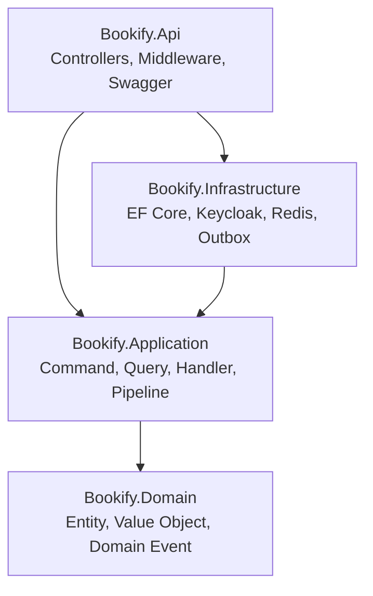
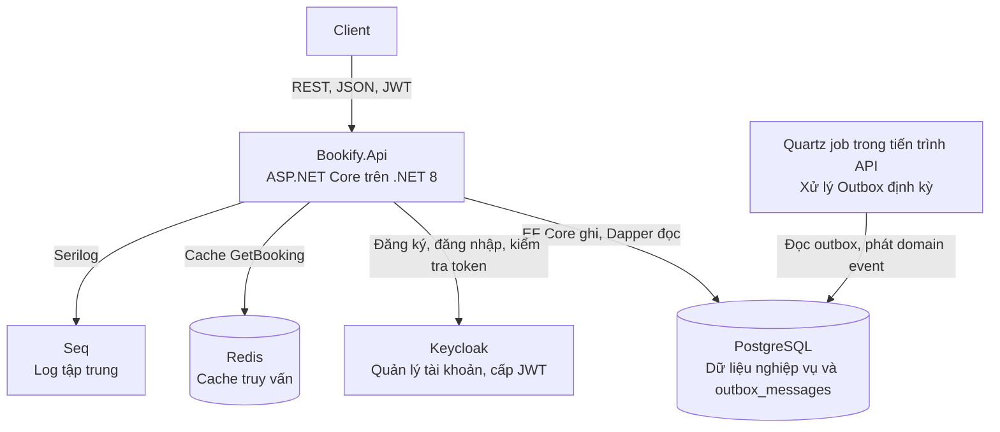
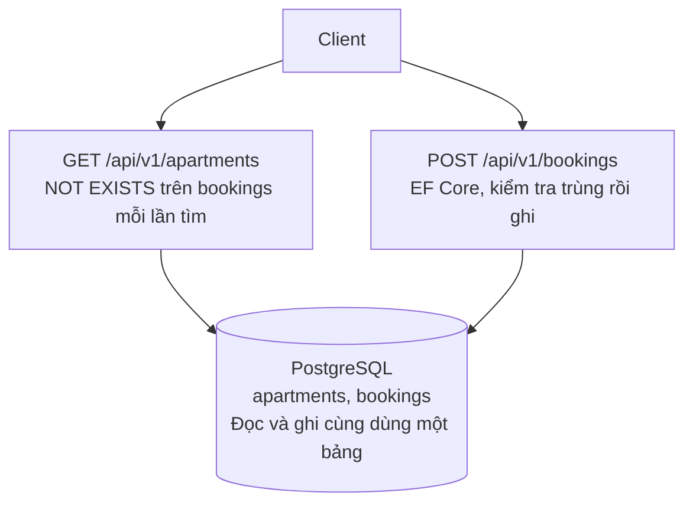
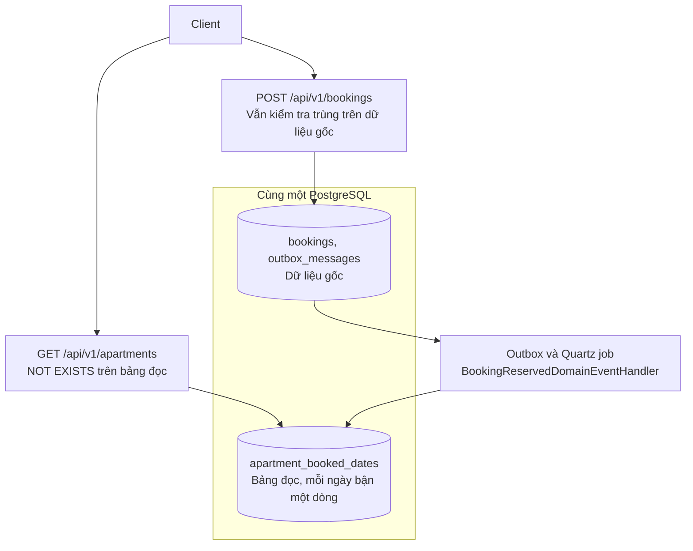
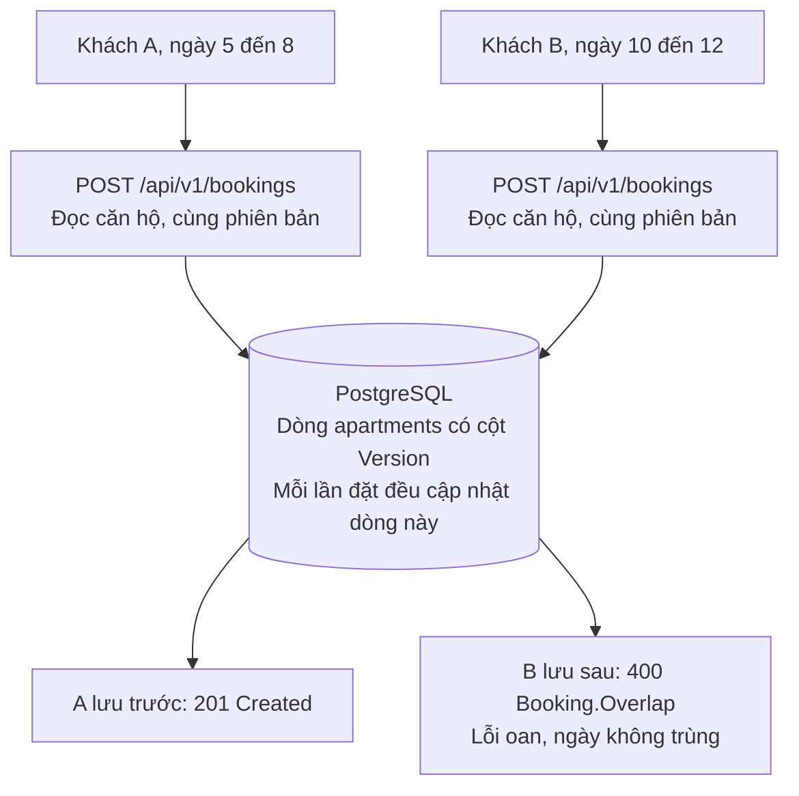
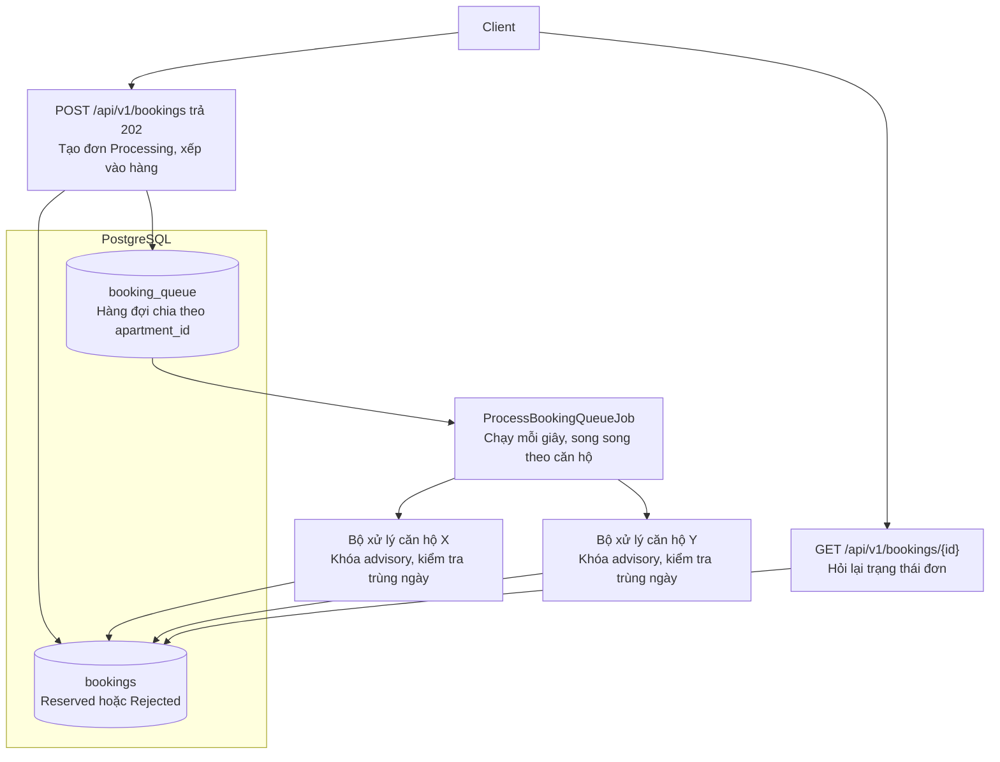

# Kiến trúc và các cải tiến của Bookify

Tài liệu này mô tả kiến trúc hệ thống trên nhánh `main` và hai cải tiến kiến trúc đã được hiện thực trên hai nhánh riêng.

## Tổng quan hệ thống

Bookify là dịch vụ REST API đặt căn hộ, viết bằng .NET 8 theo Clean Architecture kết hợp CQRS. Người dùng tìm căn hộ còn trống theo khoảng ngày, đặt phòng với giá được tính tự động, xem lại đơn và đánh giá sau khi lưu trú.

| Nhóm chức năng | Endpoint | Mô tả |
|---|---|---|
| Người dùng | `POST /api/v1/users/register` | Đăng ký tài khoản |
| | `POST /api/v1/users/login` | Đăng nhập và nhận JWT do Keycloak cấp |
| | `GET /api/v1/users/me` | Xem thông tin tài khoản đang đăng nhập |
| Căn hộ | `GET /api/v1/apartments` | Tìm căn hộ còn trống theo `startDate` và `endDate` |
| Đặt phòng | `POST /api/v1/bookings` | Kiểm tra trùng lịch, tính giá và tạo đơn |
| | `GET /api/v1/bookings/{id}` | Xem chi tiết đơn của chính mình |
| Đánh giá | `POST /api/v1/reviews` | Đánh giá một đơn đã hoàn tất |

Vòng đời đơn gồm các trạng thái `Reserved`, `Confirmed`, `Rejected`, `Cancelled` và `Completed`. Tầng Domain và Application đã có logic chuyển trạng thái, nhưng hiện chưa có endpoint hay tiến trình nền nào gọi các lệnh Confirm, Reject, Complete và Cancel. Dịch vụ gửi email mới là bản giữ chỗ.

## Kiến trúc hệ thống

### Các tầng và chiều phụ thuộc

Hệ thống gồm 4 project. Phụ thuộc luôn hướng vào trong, và Domain không biết gì về CSDL hay web framework. Quy tắc này được kiểm tra tự động bằng `Bookify.ArchitectureTests`.

| Tầng | Trách nhiệm | Thành phần chính |
|---|---|---|
| Domain | Quy tắc nghiệp vụ thuần túy | `Apartment`, `Booking`, `User`, `Review`, `PricingService`, domain event, interface repository |
| Application | Điều phối use case theo CQRS qua MediatR | Command, Query, Handler, pipeline ghi log, kiểm tra dữ liệu và cache truy vấn |
| Infrastructure | Hiện thực việc truy cập dữ liệu và dịch vụ ngoài | `ApplicationDbContext`, repository, tích hợp Keycloak, cache Redis, Outbox, phân quyền |
| Api | Điểm vào của hệ thống | Controller, xử lý ngoại lệ tập trung, ghi log theo request, versioning, Swagger, health check |

CQRS được áp dụng ở mức mã nguồn trên cùng một CSDL. Command ghi qua EF Core và repository, còn Query đọc thẳng bằng SQL qua Dapper.

### Thành phần khi chạy

| Dịch vụ | Vai trò | Cổng trên máy host |
|---|---|---|
| `bookify.api` | REST API | 5002 |
| `bookify-db` | PostgreSQL 16, CSDL chính | 5433 |
| `bookify-idp` | Keycloak, định danh và cấp JWT | 18080 |
| `bookify-redis` | Redis, cache | 6379 |
| `bookify-seq` | Seq, xem log | 5341, 8081 |

### Luồng xử lý một request đặt phòng

1. Client gửi `POST /api/v1/bookings` kèm JWT, và middleware xác thực kiểm tra token.
2. `BookingsController` tạo `ReserveBookingCommand` rồi gửi qua MediatR.
3. Pipeline ghi log và kiểm tra dữ liệu đầu vào.
4. `ReserveBookingCommandHandler` nạp người dùng và căn hộ, rồi kiểm tra trùng lịch trên bảng `bookings`.
5. `Booking.Reserve` tính giá bằng `PricingService`, tạo đơn `Reserved` và phát domain event.
6. `SaveChangesAsync` lưu đơn cùng outbox message trong một giao dịch, có kiểm tra phiên bản dòng căn hộ.
7. API trả `201 Created` kèm mã đơn. Nếu trùng lịch hoặc xung đột phiên bản, API trả `400` với lỗi `Booking.Overlap`.
8. Quartz job đọc outbox định kỳ và phát domain event tới handler để xử lý phần việc phụ.

## Cải tiến kiến trúc

| | Cải tiến 1 | Cải tiến 2 |
|---|---|---|
| Nhánh | `feature/optimize-apartment-search` | `feature/booking-queue-per-apartment` |
| Bài toán | Tìm phòng phải suy ra kết quả từ toàn bộ booking mỗi lần tìm | Đặt hai khoảng ngày khác nhau của cùng căn hộ vẫn bị báo trùng lịch |
| Gốc vấn đề | Tìm kiếm phụ thuộc vào bảng `bookings` của phía ghi | Khóa lạc quan đặt trên cả căn hộ, không theo khoảng ngày |
| Hướng giải quyết | Thêm bảng đọc tính sẵn ngày bận, cập nhật qua Outbox | Đặt phòng bất đồng bộ qua hàng đợi chia theo căn hộ |
| Cái giá phải trả | Kết quả tìm kiếm có thể chậm hơn dữ liệu gốc | Client phải xử lý trạng thái chờ và hệ thống có thêm job nền |

### Cải tiến 1: Tách mô hình đọc cho tìm kiếm căn hộ

#### Bài toán cần giải quyết

Kết quả căn hộ nào trống không được lưu sẵn. Hệ thống chỉ lưu các booking đã có, nên mỗi lần tìm, `SearchApartmentsQueryHandler` chạy `NOT EXISTS` trên bảng `bookings` cho từng căn hộ với điều kiện khoảng ngày và trạng thái. Hai người tìm cùng khoảng ngày vẫn bị tính hai lần, và dữ liệu càng nhiều thì mỗi lần tìm càng tốn.

Tìm kiếm và đặt phòng còn tranh CPU, đĩa, số kết nối và bộ đệm của cùng một PostgreSQL. Khi có đợt tìm kiếm dồn dập, thao tác đặt phòng dù nhẹ cũng có thể bị chậm.

#### Kiến trúc cũ

#### Kiến trúc mới

Bảng `apartment_booked_dates` lưu mỗi ngày bận của mỗi căn hộ thành một dòng. Tìm kiếm chỉ cần đối chiếu căn hộ với các ngày trong khoảng cần tìm, không còn đụng đến bảng `bookings`. Phía đặt phòng vẫn kiểm tra trùng trên dữ liệu gốc, nên bảng đọc có chậm cũng không gây đặt trùng.

Bảng đọc được cập nhật bất đồng bộ. Khi đơn được tạo, domain event đi qua Outbox, và `BookingReservedDomainEventHandler` ghi từng ngày bận vào bảng đọc.

#### Hạn chế của bản hiện thực

- Bảng đọc nằm trong cùng PostgreSQL, nên cải tiến giảm chi phí mỗi lần tìm nhưng chưa tách tài nguyên giữa đọc và ghi.
- Nhánh chưa có migration tạo `apartment_booked_dates` và `apartment_daily_availability`, nên phải tạo bảng thủ công trước khi chạy.
- Bảng `apartment_daily_availability` mới chỉ được ghi và chưa có truy vấn nào đọc.
- Chưa có handler xóa ngày bận khi đơn bị từ chối hoặc bị hủy, nên các ngày đó vẫn hiển thị là bận.
- Outbox chạy 10 giây một lần với mỗi lần 10 message, nên bảng đọc có thể chậm hơn dữ liệu gốc khi tải cao.
- Nhánh này đang gắn `[AllowAnonymous]` cho `POST /api/v1/bookings`, cần gỡ trước khi merge.

### Cải tiến 2: Đặt phòng qua hàng đợi theo từng căn hộ

#### Bài toán cần giải quyết

Mỗi lần đặt phòng, `Booking.Reserve` cập nhật `LastBookedOnUtc` của căn hộ, và dòng căn hộ có cột phiên bản `Version`. Hai request đọc cùng phiên bản thì request lưu sau bị từ chối. `ReserveBookingCommandHandler` biến lỗi này thành `Booking.Overlap`, nên người thua nhận lỗi trùng lịch dù ngày không hề trùng.

Với căn hộ nhiều người quan tâm, nhiều request bị lỗi oan sau khi hệ thống đã xử lý xong. Mỗi request còn giữ kết nối CSDL suốt thời gian xử lý, nên đợt đặt phòng dồn dập dễ làm nghẽn API.

#### Kiến trúc cũ

#### Kiến trúc mới

Mỗi yêu cầu được xếp vào hàng của căn hộ và xử lý lần lượt, còn các căn hộ khác nhau chạy song song.

1. API kiểm tra người dùng và căn hộ, tạo đơn ở trạng thái `Processing`, thêm một dòng vào `booking_queue` trong cùng giao dịch rồi trả `202 Accepted`.
2. Header `Idempotency-Key` giúp một yêu cầu gửi lại nhận đúng đơn đã tạo.
3. `ProcessBookingQueueJob` chạy mỗi giây, lấy tối đa 20 căn hộ đang có đơn chờ và xử lý song song tối đa 4 căn hộ.
4. Khóa `pg_try_advisory_lock` theo căn hộ bảo đảm mỗi căn hộ chỉ có một bộ xử lý, kể cả khi chạy nhiều instance API.
5. Bộ xử lý duyệt đơn theo thứ tự đến và kiểm tra trùng theo khoảng ngày thật. Đơn hợp lệ chuyển sang `Reserved`, đơn trùng ngày chuyển sang `Rejected`.
6. Đơn lỗi được thử lại tối đa 5 lần rồi chuyển sang `Rejected`, để không chặn cả hàng của căn hộ.
7. Client gọi `GET /api/v1/bookings/{id}` để biết kết quả.

#### Hạn chế của bản hiện thực

- `GetBookingQuery` vẫn được cache 1 phút, nên client hỏi lại có thể đọc phải trạng thái `Processing` đã cũ. Cần bỏ cache cho truy vấn này.
- Hàng đợi là bảng trong PostgreSQL, nên đơn giản khi vận hành nhưng vẫn dùng chung tài nguyên với CSDL chính.
- Job quét định kỳ nên mỗi đơn có thể chờ thêm đến khoảng một giây trước khi được xử lý.
- Đặt phòng không còn hoàn tất ngay, client phải xử lý trạng thái chờ.

### Phương pháp đánh giá

Mỗi cải tiến được đo trước và sau theo cùng tiêu chí, trên cùng một kịch bản và một cấu hình phần cứng cố định là CPU trên Kaggle. Dữ liệu seed hiện chỉ có 100 căn hộ và không có booking, nên cần sinh thêm booking lịch sử để tái hiện vấn đề.

| Cải tiến | Kịch bản | Tiêu chí | Trước | Sau |
|---|---|---|---|---|
| 1 | Nhiều lượt tìm kiếm dồn dập trên dữ liệu booking lớn, có đặt phòng chạy đồng thời | Độ trễ tìm kiếm, độ trễ p99 của đặt phòng, số kết nối tới CSDL, độ trễ cập nhật bảng đọc | Chưa đo | Chưa đo |
| 2 | Nhiều khách cùng đặt vài căn hộ nổi tiếng, cả ngày khác nhau lẫn ngày trùng nhau | Số lỗi oan phải bằng 0 với ngày khác nhau, số lần đặt đúng, số đơn đặt trùng phải bằng 0, p99 của API, thời gian từ lúc nhận đến lúc xử lý xong | Chưa đo | Chưa đo |

Kịch bản đặt phòng cần token từ Keycloak vì `POST /api/v1/bookings` yêu cầu đăng nhập. Endpoint tìm kiếm hiện cho phép truy cập ẩn danh.
